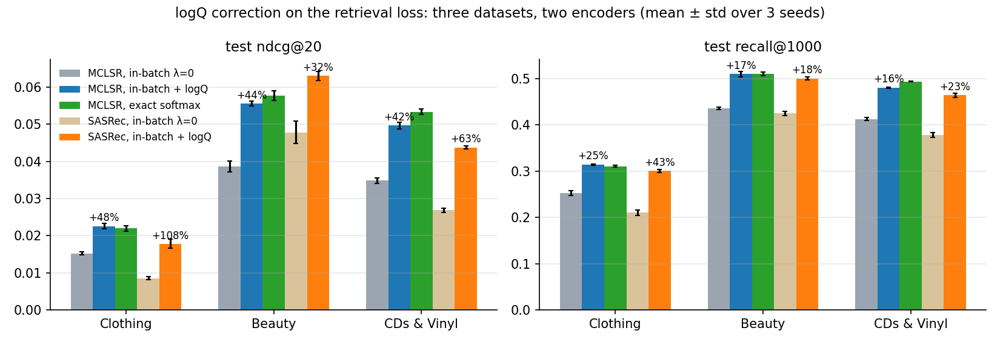
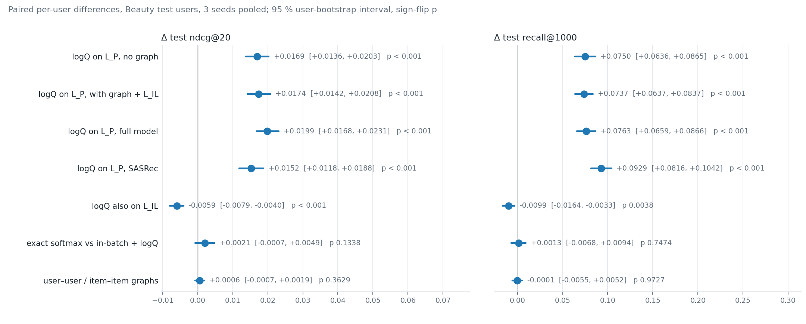

# IRec × MCLSR: a systematic study of the logQ sampling-bias correction
<p align="center">
   <a>
      
   </a>
</p>

<p align="center">
   <a href="../../actions/workflows/tests.yml">
      
   </a>
   <a>
      
   </a>
   <a href="https://github.com/astral-sh/ruff">
      
   </a>
   <a>
      
   </a>
</p>

**IRec** is a config-driven PyTorch framework for reproducible research in sequential and graph-based recommendation.

This repository hosts a systematic study of the **logQ sampling-bias correction** in a
multi-loss graph-contrastive recommender (MCLSR, CIKM'22): where the correction helps
(in-batch retrieval), where it does not (contrastive alignment losses), and why. Every
loss variant is locked in by reference tests, and every experiment is a single JSON
config away. **All experiment results with verdicts: [RESULTS.md](./RESULTS.md).**

## Start here: the study at a glance



Test ndcg@20 / recall@1000 over the full catalogue, mean of three seeds (model selected on validation, test read once):

| | Clothing | Beauty | CDs & Vinyl ("Toys" in the MCLSR paper) |
|---|---|---|---|
| MCLSR, in-batch sampled softmax, no correction | 0.0152 / 0.252 | 0.0386 / 0.436 | 0.0349 / 0.413 |
| **MCLSR, in-batch + logQ on the retrieval loss** | **0.0226 / 0.314** | **0.0556 / 0.510** | **0.0497 / 0.481** |
| MCLSR, exact full-catalogue softmax | 0.0219 / 0.311 | 0.0577 / 0.510 | 0.0534 / 0.494 |
| full MCLSR (graph + alignment loss), logQ on retrieval | 0.0261 / 0.358 | 0.0567 / 0.540 | 0.0497 / 0.508 |
| full MCLSR, logQ also on the alignment loss | 0.0249 / 0.344 | 0.0508 / 0.529 | 0.0489 / 0.505 |
| SASRec, in-batch: no correction → logQ | 0.0085 → 0.0178 | 0.0478 → 0.0631 | 0.0268 → 0.0438 |

1. The correction on the retrieval loss gives +42…+48 % ndcg@20 on MCLSR and +32…+108 % on SASRec, positive on every seed of every dataset, and recovers 80–100 % of the exact-softmax gain.
2. The same correction on the contrastive alignment loss hurts; the mechanism is a margin, not a sampling correction (a constant-q "correction" reproduces the harm).
3. The graph and the correction are additive; the graph alone does not repair the popularity bias and adds tail recall only. The user–user and item–item graphs of the paper contribute nothing; the alignment loss is what makes the graph useful.
4. The three published forms of the correction (negatives-only, Yi et al., Khrylchenko–Baikalov et al. RecSys'25) are indistinguishable here; the loss weights of the original paper are optimal within noise.
5. The gain does not depend on this implementation's choices: in the paper's own cosine form of the contrastive losses the correction still adds +0.014 ndcg@20 on Beauty (3 seeds, p = 0.0001), and the whole pipeline is verified independently stage by stage (below).

Where to look:

- [RESULTS.md](./RESULTS.md) — figures, headline tables, mechanism and sensitivity tables, component ablation (Part A); the original single-seed Clothing study (Part B).
- [RUN_INDEX.md](./RUN_INDEX.md) — every training run of the study (≈150 arms, ≈280 runs), labelled, with links to its config.
- Per-run reports with content hashes: [results/confirm/](./results/confirm/).
- Code: the correction variants and the exact softmax in [src/irec/loss/retrieval.py](./src/irec/loss/retrieval.py) (`InBatchLogQLoss` with the three forms, `FullSoftmaxLoss`) and [src/irec/loss/contrastive.py](./src/irec/loss/contrastive.py) (`FpsLoss`, `FpsLogQLoss`), the model in [src/irec/models/mclsr.py](./src/irec/models/mclsr.py), the confirmatory runner [scripts/train_confirmatory.py](./scripts/train_confirmatory.py), and two independent replications of the headline effect with no framework code, [scripts/indep_check_beauty.py](./scripts/indep_check_beauty.py) and [scripts/indep_check_clothing.py](./scripts/indep_check_clothing.py).

> **Attribution.** IRec is a shared research framework developed by our team (started at the ITMO CT Machine Learning Lab); this repository is my working copy. The from-scratch MCLSR reimplementation and the logQ study here are my own contribution.

## Verification

Every stage of the pipeline has an independent check that does not reuse the code it verifies:
the split files are rebuilt from the raw ratings and diffed, the three graphs are recomputed with
scipy, the forward pass and all losses are reimplemented in numpy from the saved weights, a
synthetic end-to-end run must reproduce itself seed for seed, and the headline comparisons carry
paired per-user bootstrap intervals. What each check covers and how to run it:
[VERIFICATION.md](./VERIFICATION.md).



## Repository layout

| path | what |
|---|---|
| `src/irec/` | the framework, reduced to the study: `models/` (`mclsr`, `sasrec`), `loss/retrieval.py` (L_P with the three forms of the correction, the exact softmax), `loss/contrastive.py` (L_IL / L_UC / L_IC forms), `dataset/sequences.py` and `dataset/graph.py` (the files and the three graphs), metrics, callbacks; every class carries its paper equation |
| `configs/train/beauty/`, `configs/train/toys/` (CDs & Vinyl), `configs/train/clothing64/` | the arms of the multi-seed study, one question per config — [configs/README.md](./configs/README.md) explains the numbering and every knob |
| `configs/train/grid/`, `configs/train/legacy/` | the original single-seed Clothing grid; historical configs kept for provenance |
| `scripts/` | data preparation, the confirmatory runner and queues, summaries, the independent checks, figures — [scripts/README.md](./scripts/README.md) |
| `tests/` | reference implementations of every loss and metric, graph construction, config validation, runtime, and a synthetic end-to-end run (all in CI) |
| `results/confirm/`, `results/stats/`, `results/deciles/`, `results/explor/` | per-run reports with content hashes, paired bootstrap tables, decile analyses, summaries of the exploratory runs |
| `RESULTS.md`, `RUN_INDEX.md`, `VERIFICATION.md`, `REPRODUCE.md` | the results with verdicts; every run of the study; what was checked and how; the end-to-end recipe |
| `notebooks/` | the original dataset preprocessing notebook (superseded by `scripts/prepare_dataset.py`, which reproduces its files exactly) and dataset statistics |

## Quick start

```bash
uv venv --python 3.12 && source .venv/bin/activate && uv sync --frozen
export PYTHONPATH=src
python -m pytest -q tests                                                   # ~10 s on a CPU
python scripts/prepare_dataset.py --csv data/Clothing/data.csv --out data/Clothing
python scripts/generate_item_counts.py --input data/Clothing/train_sasrec.txt --output data/Clothing/item_counts.pkl --num_items 23033
python scripts/train_confirmatory.py --params configs/train/clothing64/02_logq_downstream.json --seed 1 \
    --output results/confirm/clothing64_02_logq_downstream_seed1.json
python scripts/summarize_seeds.py --prefix clothing64
```

The full recipe — data from the raw ratings, every table, the queues, the summaries, the
uncertainty and the figures — is in [REPRODUCE.md](./REPRODUCE.md); `make test`, `make verify`,
`make smoke`, `make figures` and `make index` wrap the usual steps.

## Tests and checks

`python -m pytest -q tests` runs in CI on every push: every loss variant and every metric against a
hand-written reference, graph construction against dense algebra, validation of every config, the
runtime (exact step limits, multi-metric best tracking), and a synthetic end-to-end training run
that must reproduce itself seed for seed. The independent checks on real data (data rebuilt from
the raw ratings, graphs recomputed with scipy, both encoders re-implemented in numpy, paired
bootstrap of the headline comparisons) are described in [VERIFICATION.md](./VERIFICATION.md).
